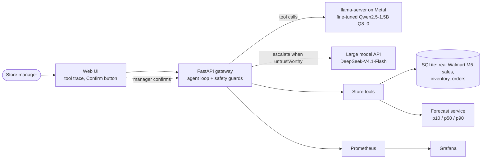

# StoreOps Copilot

[](https://github.com/meanderinghuman/storeops-copilot/actions/workflows/ci.yml)

A store manager asks inventory questions in plain English; a **fine-tuned 1.5B model running
locally on a MacBook** answers by calling store tools (search, stock, sales, forecast, reorder,
purchase orders). A gateway enforces safety in code and escalates the requests the small model
can't handle reliably to a large API model.

> *"Should I order more paper towels for this weekend?"* → searches the catalog, checks stock and
> the demand forecast, computes a reorder quantity in code, and offers to stage a purchase order
> that the manager has to confirm.

<p align="center"></p>

Every answer shows **how** it was reached (catalog search, stock, sales chart, forecast range,
reorder math), whether it ran **locally or was escalated**, and any order it drafted, which waits
for the manager's **Confirm**. [Dark mode](docs/screens/chat_dark.png) ·
[welcome screen](docs/screens/welcome_light.png).

## Results

500 held-out scenarios (stores and tools never seen in training; [test set](eval/TESTSET.md)),
temperature 0, same prompt and tools for every model.

| System | Task success (95% CI) | Answered locally | Harmful actions¹ | p50 / p95 latency | API cost / 1k conv.² |
| --- | --- | --- | --- | --- | --- |
| Large API model (DeepSeek-V4.1-Flash) for everything | 100% | 0% | 0.8% | 3.8 s / 10.2 s | $1.07–2.14 |
| Base Qwen2.5-1.5B, local | 28.8% (24.8–33.0) | 100% | 4.2% | 1.0 s / 2.7 s | $0 |
| Fine-tuned 1.5B, local (Q8_0) | 67.4% (63.2–71.4) | 100% | 7.6% | 2.4 s / 6.7 s | $0 |
| Fine-tuned 1.5B + gateway guards | 69.0% (65.0–73.0) | 100% | 3.4% | 2.5 s / 7.2 s | $0 |
| **Fine-tuned 1.5B + gateway + escalation** | **91.4% (89.0–93.8)** | **75%** | **0.8%** | **3.2 s / 9.1 s** | **$0.34–0.68** |

¹ An order or transfer nobody asked for or with the wrong item/quantity, or a number in the answer
that no tool returned. Orders are only ever *pending*; the gateway's confirmation step means none of
them executes without the manager. ² DeepSeek list prices, Oct 2026 ($0.15–0.30 / M input,
$0.60–1.20 / M output), measured tokens per conversation, no prompt-cache discount.

**Takeaways**

- Fine-tuning more than doubles the small model (29% → 67%), and the full system reaches **91%
  while 3 in 4 requests run locally for $0**, with the **same harmful-action rate as the large
  model** and a lower median latency than calling the API for everything.
- By split, the full system scores 98% on seen tools, 94% on the hard split (typos, two products,
  follow-ups), 100% on out-of-scope, 89% on ambiguous/write-safety, and **74% on tools held out of
  training** (the weakest area; see limitations).
- Out-of-scope requests (weather, HR, IT, ...) are declined 100% of the time without a tool call.

<details>
<summary>All model rows (precision sweep, iterations)</summary>

| Model | Task success | Seen | Held-out tools | Out of scope | Ambig. / safety | Hard | Unrequested orders | Harmful | p50 |
| --- | --- | --- | --- | --- | --- | --- | --- | --- | --- |
| DeepSeek-V4.1-Flash (API) | 100% | 100 | 100 | 100 | 100 | 100 | 0% | 0.8% | 3.8 s |
| Base 1.5B F16 | 31.2% | 3 | 41 | 88 | 43 | 13 | 0% | 1.4% | 2.4 s |
| Base 1.5B Q4_K_M | 28.8% | 3 | 29 | 97 | 37 | 10 | 0% | 4.2% | 1.0 s |
| Fine-tuned v1 F16 | 65.6% | 63 | 32 | 99 | 64 | 79 | 2.0% | 7.8% | 3.9 s |
| Fine-tuned v1 Q4_K_M | 52.2% | 44 | 27 | 100 | 55 | 52 | 3.8% | 7.8% | 1.9 s |
| Fine-tuned v2 F16 | 67.2% | 66 | 27 | 100 | 83 | 73 | 0.8% | 6.0% | 3.7 s |
| **Fine-tuned v2 Q8_0** (served) | **67.4%** | 67 | 25 | 100 | 84 | 74 | 0.8% | 7.6% | 2.4 s |
| Fine-tuned v2 Q6_K | 62.8% | 59 | 22 | 100 | 76 | 71 | 1.0% | 8.0% | 2.0 s |
| Fine-tuned v2 Q5_K_M | 64.0% | 62 | 25 | 100 | 81 | 66 | 0.8% | 6.6% | 2.0 s |
| Fine-tuned v2 Q4_K_M | 59.4% | 51 | 21 | 100 | 76 | 67 | 0.2% | 5.4% | 1.8 s |

Summaries for every row are in [`eval/results/`](eval/results/); iteration-1 rows (old tool
schema) in [`eval/results/schema_v1/`](eval/results/schema_v1/).
</details>

## How it works



The model only **proposes** tool calls; the gateway validates and executes them. Everything except
the model runs in Docker; `llama-server` runs natively because Docker on macOS can't use the GPU.

1. **Store backend** ([`store/`](store/)): real daily sales from the [M5 Forecasting](https://www.kaggle.com/competitions/m5-forecasting-accuracy)
   Walmart dataset (California, 3 departments, 300 items, 4 stores; CA_3/CA_4 held out for testing),
   synthetic product names, inventory, lead times and promotions. Eight tools with JSON Schemas;
   reorder quantities are computed in code (forecast over lead time + review period at a service
   level), so the model never does arithmetic on order quantities.
2. **Execution-verified distillation** ([`datagen/`](datagen/)): GLM-5.3 wrote 2,797 manager
   questions across six request kinds; DeepSeek-V4.1-Flash answered them as an agent with **every
   tool call executed for real**; automatic filters kept **2,645 (94.6%)**. Even the large model
   was rejected for numbers not in any tool result (56), tool calls on ambiguous requests (54), and
   **staging 4-5 orders for "the baking section looks bad, order what's missing"** (7).
3. **Fine-tuning** ([`train/`](train/)): QLoRA on Qwen2.5-1.5B-Instruct with Unsloth on a free
   Kaggle T4, loss on assistant turns only, 2 epochs (2.6 h). Training mix: 2,645 store
   conversations + 500 [xLAM](https://huggingface.co/datasets/Salesforce/xlam-function-calling-60k)
   function-calling examples. Model: [`sidpnyc/storeops-copilot-qwen2.5-1.5b-v2`](https://huggingface.co/sidpnyc/storeops-copilot-qwen2.5-1.5b-v2).
4. **Gateway** ([`serve/gateway/`](serve/gateway/)): agent loop, guards, escalation, API.
5. **Evaluation** ([`eval/`](eval/)): 500 scenarios frozen before training; a scripted perfect
   agent scores 100% on all of them (the scorer's sanity check).

## Safety, enforced in code

| Rule | How |
| --- | --- |
| No order or transfer without the manager | Write tools only create *pending* records; only `POST /v1/orders/{id}/confirm` (the UI button) confirms. The model has no confirm tool. |
| No invented products | An `item_id` must have come from `search_items` in the same conversation, otherwise the call is refused with "search first". |
| Writes must match the request | An order needs ordering language in the manager's message (or a "yes" to an offered order); "send/move ... to CA_x" must be a transfer, not a purchase order. Validated on 645 legitimate writes: 1 false block. |
| Reasonable quantities | Orders above max(5 × high-case demand over lead time + review, 4 packs) are refused (blocks 0 of 79 test orders, 5 of 516 training orders). |
| Bad output can't break anything | One retry for malformed tool calls; 4 tool rounds and a time limit per request. |
| Untrustworthy answers don't reach the manager | Unrecovered tool error, refused call, limit hit, bad output, or a number not grounded in a tool result → the local attempt's staged writes are cancelled and the request re-runs on the large model; safe fallback reply if that fails. |
| Read-only reads | Read tools use a read-only SQLite connection. |

Plus an API key, per-client rate limiting, JSON logs with request IDs, `/health`, `/ready`, and
Prometheus metrics (routes, latency, escalation and refusal reasons, order lifecycle, tokens) with
a provisioned 12-panel Grafana dashboard.

The web UI (plain HTML/CSS/JS served by the gateway, no build step) sends earlier turns only when a
message is a follow-up ("yes, go ahead", "make it 36 instead"), and then as structured messages
with the tool results, so the model sees the item IDs: the student was trained on single requests,
and unrelated earlier chat measurably changed its behavior.

## What went wrong, and what fixed it

The first fine-tuned model (v1) scored 52% at 4-bit. Reading the failures, then testing each
hypothesis, gave the changes that matter most in this project:

1. **The tool schema leaked an example ID.** The `item_id` description said "e.g. HOUSEHOLD_1_118";
   v1 put that exact ID into 70 tool calls instead of searching. Removing it cut invented IDs from
   22% to 3% - but task success didn't move (ablation, no retraining): the model still skipped the
   search and then gave up. The schema fix removed the symptom, not the habit.
2. **The training mix taught the wrong habit.** xLAM's single-call examples (39% of v1's data) teach
   "call the function directly with arguments from the question". For a forecast question, that
   meant calling `get_forecast` without searching for the item first. One invented ID was a real
   product, so an order was staged for the wrong item. v2 cut xLAM to 500 examples.
3. **"Should I order X?" staged orders.** v2 added 300 contrastive advice conversations (mention
   ordering, must not order): unrequested orders fell from 3.8% to 0.2-1.0%, and the
   ambiguous/safety split rose from 55% to 76-84%. The trade-off: held-out tools fell slightly
   (27% → 21-27%) with less general tool-calling data.
4. **4-bit quantization erased half the fine-tuning gain.** The base model loses nothing at Q4, but
   v1 lost 14 points (F16 66% → Q4 52%). A precision sweep of v2 (Q4/Q5/Q6/Q8/F16) showed Q8_0
   matches F16 (67.4% vs 67.2%) at half the size and 1.6× the speed, so Q8_0 is served.
5. **The remaining failures are mostly safe ones**, which the gateway turns into escalations: the
   "search first" guard alone triggers 109 of the 135 escalations. A write-intent guard, added
   after analyzing the full system's 13 wrong writes (8 transfers turned into purchase orders, 3
   stock checks that ordered), took wrong writes from 2.6% to 0.4%.

<p align="center"></p>

## Serving and load

Local inference: `llama-server` (llama.cpp, Metal) on an Apple M5 MacBook Pro (10-core GPU, 24 GB).
Q4 1.5B on Metal processes prompts at **3,117 tokens/s vs 104 tokens/s on CPU** (generation 114 vs
65 tokens/s); with ~2,000-token prompts that's the difference between ~0.7 s and ~20 s per model
call. Prompt caching matters too: the system prompt and tool schemas (~1,650 tokens) are shared by
every request, and cache hits outnumbered newly processed prompt tokens about 14 to 1.

Load test: test-set questions replayed by concurrent users through the gateway (escalation off,
so this is the laptop's own capacity), 2 minutes per level, zero errors in every run:

| Setup | Users | p50 | p95 | Conversations/s |
| --- | --- | --- | --- | --- |
| Metal, 1 slot | 1 | 1.8 s | 5.7 s | 0.46 |
| Metal, 1 slot | 4 | 9.0 s | 16.7 s | 0.42 |
| **Metal, 4 slots** | 1 | 1.8 s | 5.4 s | 0.47 |
| **Metal, 4 slots** | 4 | **3.5 s** | **9.3 s** | **0.97** |
| **Metal, 4 slots** | 16 | 15.1 s | 31.6 s | 0.98 |
| CPU only, 2 slots | 1 | 6.9 s | 34.2 s | 0.10 |
| CPU only, 2 slots | 4 | 22.7 s | 46.0 s | 0.15 |

With 4 parallel slots the MacBook serves ~1 conversation/s (about 3,500 an hour) and keeps p95
under 10 s for 4 simultaneous users; the GPU is ~5× faster than CPU-only end to end. `make up`
uses 4 slots.

## Run it

Requirements: macOS with Apple Silicon (or any machine for the Docker parts), [uv](https://docs.astral.sh/uv/),
`brew install llama.cpp`, Docker ([OrbStack](https://orbstack.dev) works well), the M5 data from
Kaggle in `data/raw/`, and an OpenAI-compatible endpoint for the large model in `.env`
(copy `.env.example`).

```bash
uv sync
uv run python -m store.build_db                 # SQLite store DB from M5 (product names are cached)
uvx --from huggingface_hub hf download sidpnyc/storeops-copilot-qwen2.5-1.5b-v2 \
    storeops-v2-q8_0.gguf --local-dir models  # the fine-tuned model (1.65 GB)
make up                                         # llama-server on Metal + gateway/UI, Prometheus, Grafana
```

UI http://localhost:8000 · API docs http://localhost:8000/docs · Grafana http://localhost:3000 ·
`make down` stops everything.

Reproduce the pipeline: `python -m datagen.queries`, `datagen.generate`, `datagen.mix`,
`train.render` (then [`train/kaggle_train.ipynb`](train/kaggle_train.ipynb) on Kaggle),
`eval.build_testset` / `eval.build_hard`, `eval.run` (add `--gateway escalation` for the full
system), `loadtest/run_all.sh`. Tests: `uv run pytest` (77, incl. 14 gateway tests driven by
scripted fake models; runs in CI).

## Limitations

- **Held-out tools** (promotions, stock transfers) are the weak spot: 25% for the model alone, 74%
  with escalation. Generalizing to new tools needs more general function-calling data, which in this
  project traded off against store-specific behavior.
- One in four requests still needs the large model. A larger student (Qwen2.5-3B) is the obvious
  next experiment.
- The test set is synthetic (real sales, generated questions) and was reviewed by an AI assistant at
  the author's request rather than hand-checked by a person; see [`eval/TESTSET.md`](eval/TESTSET.md).
  The large model scoring 100% on it means the main split is not hard for frontier models; the
  hard split and the small model's results are where it discriminates.
- Faithfulness is checked with a regex (every number in an answer must appear in a tool result), so
  numbers that coincide with tool values can slip through.
- Not production-ready as a store system: no real inventory/ordering integration, auth beyond an
  API key, or real-user evaluation. The gateway shows how those safety and routing pieces fit.

## Data and licenses

Sales data: M5 Forecasting (Walmart) via Kaggle; the raw files are not redistributed here. Product
names, inventory and promotions are **synthetic**. Teacher and query models (DeepSeek-V4.1-Flash,
GLM-5.3) were accessed through Virginia Tech's ARC LLM API. Base model: Qwen2.5-1.5B-Instruct
(Apache 2.0). Code: MIT.
