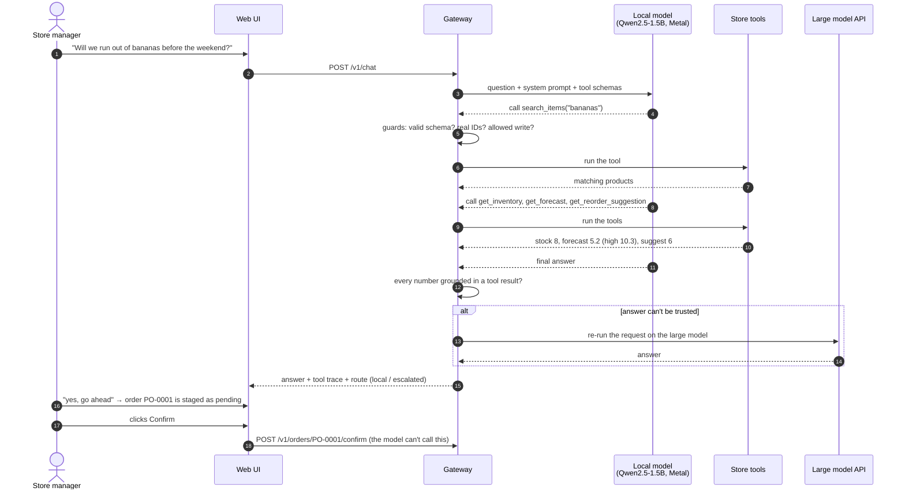
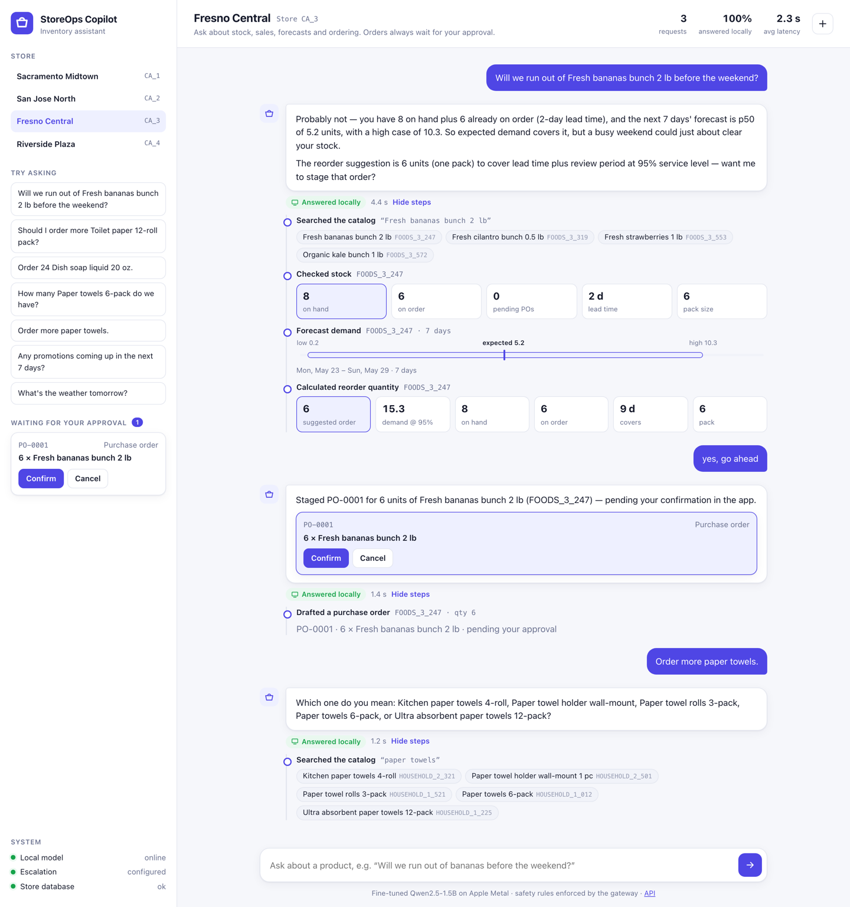
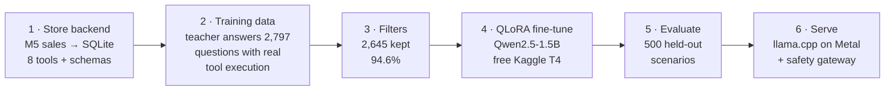

<div align="center">

# 🛒 StoreOps Copilot

**A fine-tuned 1.5B model that answers store managers' inventory questions by calling store tools,
running locally on a MacBook, with a safety gateway that escalates hard requests to a large model.**

[](https://github.com/meanderinghuman/storeops-copilot/actions/workflows/ci.yml)

[](https://huggingface.co/sidpnyc/storeops-copilot-qwen2.5-1.5b-v2)


[](LICENSE)


</div>

> *"Will we run out of bananas before the weekend?"* → the copilot searches the catalog, checks stock
> and the demand forecast, computes a reorder quantity in code, and offers to stage a purchase order.
> *"Yes, go ahead"* → a pending order appears, and nothing is placed until the manager clicks **Confirm**.

## At a glance

| | |
| --- | --- |
| 🎯 **91.4% task success** on 500 held-out scenarios | stores and tools never seen in training |
| 💻 **75% of requests answered locally**, for $0 | fine-tuned Qwen2.5-1.5B on Apple Metal |
| 🛡️ **0.8% harmful actions**, same as the large model | safety rules enforced in code, not in the prompt |
| ⚡ **3.2 s median** per conversation | faster than sending everything to the API (3.8 s) |
| 💸 **68% lower API cost** | only the hard 25% goes to the large model |
| 📈 **29% → 67%** from fine-tuning alone | execution-verified training data, QLoRA on a free T4 |

---

## How it works

Follow one request through the system:



**Step by step:**

1. **The manager asks a question** in the web UI, in plain English (typos are fine).
2. **The gateway sends it to the local model** with the system prompt and the store tools' JSON
   Schemas. The model runs natively on the Mac's GPU through `llama-server`.
3. **The model proposes tool calls**: search the catalog, check stock, pull sales, forecast demand,
   get a reorder suggestion, draft an order. It never runs anything itself.
4. **The gateway checks every call** before running it: the arguments must match the schema, the
   product ID must come from a search in this conversation (no invented IDs), an order must match
   what the manager asked for, and quantities must be reasonable.
5. **The tools run against the store database** (real Walmart M5 sales data) and the forecast
   service. Reorder quantities are calculated in code, so the model never does arithmetic on orders.
6. **The gateway checks the answer.** Every number must appear in a tool result. If anything looks
   wrong (a refused call, an error, a made-up number, too many steps), anything the local attempt
   drafted is cancelled and the request is re-run on a large model API. 75% of requests never need it.
7. **Orders are only ever drafts.** They wait in an approval queue; only the manager's **Confirm**
   button places them. The model has no tool that can confirm anything.
8. **Everything is observable:** each answer shows its steps and route in the UI, and Prometheus +
   Grafana track latency, local vs escalated share, refusals and the order lifecycle.

<p align="center"></p>
<p align="center"><sub>Every answer shows how it was reached. <a href="docs/screens/chat_dark.png">Dark mode</a> · <a href="docs/screens/welcome_light.png">welcome screen</a>. Store names are fictional labels for the dataset's anonymized California stores.</sub></p>

## How it was built



1. **Store backend** ([`store/`](store/)): real daily sales from the
   [M5 Forecasting](https://www.kaggle.com/competitions/m5-forecasting-accuracy) Walmart dataset
   (California, 3 departments, 300 products, 4 stores, 2 of them kept out of training entirely) plus
   generated product names, inventory, lead times and promotions. Eight tools with JSON Schemas and
   a forecast service that returns low / expected / high demand.
2. **Execution-verified training data** ([`datagen/`](datagen/)): one large model (GLM-5.3) wrote
   2,797 realistic manager questions; another (DeepSeek-V4.1-Flash) answered them as an agent, with
   **every tool call executed for real** against the store database.
3. **Automatic filters** keep a conversation only if every number in the answer comes from a tool
   result, orders are staged only when asked (and end with a confirmation request), vague requests
   get a clarifying question and off-topic ones get no tool call: 2,645 kept (94.6%).
4. **Fine-tuning** ([`train/`](train/)): QLoRA on Qwen2.5-1.5B-Instruct with Unsloth on a free
   Kaggle T4, loss on the assistant's turns only, 2 epochs in 2.6 hours, plus 500 general
   function-calling examples from [xLAM](https://huggingface.co/datasets/Salesforce/xlam-function-calling-60k).
5. **Evaluation** ([`eval/`](eval/)): [500 scenarios](eval/TESTSET.md) frozen in git before
   training, at stores and with two tools the model never saw, plus a hard split (typos, two products
   in one message, follow-ups). A scripted perfect agent scores 100%, which checks the scorer itself.
6. **Serving** ([`serve/`](serve/)): `llama-server` on the Mac's GPU, a FastAPI gateway with the
   safety rules and escalation, the web UI, and Prometheus + Grafana, all started by `make up`.

## Results

500 held-out scenarios, temperature 0, the same prompt and tools for every model.

| System | Task success (95% CI) | Answered locally | Harmful actions¹ | p50 / p95 latency | API cost / 1k conversations² |
| --- | --- | --- | --- | --- | --- |
| Large API model (DeepSeek-V4.1-Flash) for everything | 100% | 0% | 0.8% | 3.8 s / 10.2 s | $1.07–2.14 |
| Base Qwen2.5-1.5B, local | 28.8% (24.8–33.0) | 100% | 4.2% | 1.0 s / 2.7 s | $0 |
| Fine-tuned 1.5B, local | 67.4% (63.2–71.4) | 100% | 7.6% | 2.4 s / 6.7 s | $0 |
| Fine-tuned 1.5B + gateway guards | 69.0% (65.0–73.0) | 100% | 3.4% | 2.5 s / 7.2 s | $0 |
| **Fine-tuned 1.5B + gateway + escalation** | **91.4% (89.0–93.8)** | **75%** | **0.8%** | **3.2 s / 9.1 s** | **$0.34–0.68** |

¹ An order or transfer nobody asked for or with the wrong item or quantity, or a number in the
answer that no tool returned. Orders are only ever drafts, so none of them executes without the
manager. ² DeepSeek list prices, Oct 2026 ($0.15–0.30 / M input, $0.60–1.20 / M output) and measured
tokens per conversation.

By scenario type, the full system scores **98%** on everyday questions, **94%** on the hard split,
**100%** on off-topic requests (declined without a tool call), **89%** on vague and "should I
order?" requests, and **74%** on the two tools held out of training.

<details>
<summary><b>Every model and precision tested</b></summary>

| Model | Task success | Everyday | Held-out tools | Off-topic | Vague / safety | Hard | Unrequested orders | Harmful | p50 |
| --- | --- | --- | --- | --- | --- | --- | --- | --- | --- |
| DeepSeek-V4.1-Flash (API) | 100% | 100 | 100 | 100 | 100 | 100 | 0% | 0.8% | 3.8 s |
| Base 1.5B F16 | 31.2% | 3 | 41 | 88 | 43 | 13 | 0% | 1.4% | 2.4 s |
| Base 1.5B Q4_K_M | 28.8% | 3 | 29 | 97 | 37 | 10 | 0% | 4.2% | 1.0 s |
| Fine-tuned v1 F16 | 65.6% | 63 | 32 | 99 | 64 | 79 | 2.0% | 7.8% | 3.9 s |
| Fine-tuned v1 Q4_K_M | 52.2% | 44 | 27 | 100 | 55 | 52 | 3.8% | 7.8% | 1.9 s |
| Fine-tuned v2 F16 | 67.2% | 66 | 27 | 100 | 83 | 73 | 0.8% | 6.0% | 3.7 s |
| **Fine-tuned v2 Q8_0** (served) | **67.4%** | 67 | 25 | 100 | 84 | 74 | 0.8% | 7.6% | 2.4 s |
| Fine-tuned v2 Q6_K | 62.8% | 59 | 22 | 100 | 76 | 71 | 1.0% | 8.0% | 2.0 s |
| Fine-tuned v2 Q5_K_M | 64.0% | 62 | 25 | 100 | 81 | 66 | 0.8% | 6.6% | 2.0 s |
| Fine-tuned v2 Q4_K_M | 59.4% | 51 | 21 | 100 | 76 | 67 | 0.2% | 5.4% | 1.8 s |

Summaries for every row: [`eval/results/`](eval/results/) (first-iteration runs in
[`schema_v1/`](eval/results/schema_v1/)).
</details>

## Safety, enforced in code

| Rule | How |
| --- | --- |
| 🔒 No order or transfer without the manager | Tools can only create **pending** drafts; only `POST /v1/orders/{id}/confirm` (the UI's Confirm button) places them. The model has no confirm tool. |
| 🔎 No invented products | A product ID must come from a catalog search in the same conversation, or the call is refused with "search first". |
| ✍️ Actions match the request | An order needs ordering language in the manager's message (or a "yes" to an offered order); "send / move … to another store" must be a transfer. Checked on 645 real orders: 1 false block. |
| 📦 Reasonable quantities | Orders above max(5 × high-case demand over lead time + review, 4 packs) are refused. |
| 🧯 Bad output can't break anything | One retry for malformed tool calls; at most 4 tool rounds and a time limit per request. |
| ↗️ Untrustworthy answers don't reach the manager | Refused calls, errors, limits or made-up numbers → the local attempt's drafts are cancelled and the request re-runs on the large model; a safe fallback reply if that fails too. |
| 👀 Read-only reads | Read tools use a read-only database connection. |

Plus API-key auth, per-client rate limiting, JSON logs with request IDs, `/health`, `/ready`, and
Prometheus metrics behind a 12-panel Grafana dashboard. 78 tests (15 drive the gateway with a
scripted fake model) run in CI on every push.

## What went wrong, and what fixed it

The first fine-tuned model scored 52% (at 4-bit). Reading the failures and testing one hypothesis
at a time led to the changes that mattered most:

1. **The tool schema leaked an example ID.** The `item_id` description said "e.g. HOUSEHOLD_1_118",
   and the model put that exact ID into 70 tool calls instead of searching. Removing it cut invented
   IDs from 22% to 3%, but task success didn't move: the model still skipped the search. The schema
   fix removed a symptom, not the habit.
2. **The training mix taught the wrong habit.** General function-calling examples (39% of the first
   training set) show calling a function directly with arguments from the question. For a forecast
   question that meant calling `get_forecast` without looking the product up first, and once it
   drafted an order for the wrong product. The second version cut those examples to 500.
3. **"Should I order X?" drafted orders.** 300 extra training conversations that mention ordering but
   must not order brought unrequested orders from 3.8% to under 1%, and lifted the vague / safety
   scenarios from 55% to 84%.
4. **4-bit quantization erased half the fine-tuning gain.** The base model loses nothing at 4-bit, but
   the fine-tuned model lost 14 points. A precision sweep (4/5/6/8/16-bit) showed 8-bit matches full
   precision (67.4% vs 67.2%) at half the size and 1.6× the speed, so 8-bit is what's served.
5. **The gateway turns the remaining failures into safe ones.** The "search first" rule triggers most
   escalations, and a write-intent rule (added after finding 8 transfers turned into purchase orders
   and 3 stock checks that ordered) cut wrong orders from 2.6% to 0.4%.

<p align="center"></p>

## Performance

Measured on an Apple M5 MacBook Pro (10-core GPU, 24 GB):

| | GPU (Metal) | CPU only |
| --- | --- | --- |
| Prompt processing (1.5B, 4-bit) | **3,117 tokens/s** | 104 tokens/s |
| Generation | **114 tokens/s** | 65 tokens/s |
| One user, per conversation (p50 / p95) | **1.8 s / 5.4 s** | 6.9 s / 34 s |

Load test (real test-set questions, concurrent users, 2 minutes per level, zero errors):

| Setup | Users | p50 | p95 | Conversations / s |
| --- | --- | --- | --- | --- |
| Metal, 1 slot | 4 | 9.0 s | 16.7 s | 0.42 |
| **Metal, 4 slots** | **4** | **3.5 s** | **9.3 s** | **0.97** |
| Metal, 4 slots | 16 | 15.1 s | 31.6 s | 0.98 |
| CPU only, 2 slots | 4 | 22.7 s | 46.0 s | 0.15 |

One MacBook serves about 1 conversation per second (~3,500 an hour) with 4 parallel slots. The
system prompt and tool schemas (~1,650 tokens) are shared by every request and stay in llama.cpp's
prompt cache, which is a large part of why local latency stays low.

---

## Run it on your machine

### What you need

- **A Mac with Apple Silicon** (M1 or newer, 16 GB+ RAM recommended). Linux with an NVIDIA GPU works
  too with a CUDA build of llama.cpp; CPU-only works but is ~5× slower.
- [**uv**](https://docs.astral.sh/uv/) (Python package manager): `curl -LsSf https://astral.sh/uv/install.sh | sh`
- **llama.cpp**: `brew install llama.cpp`
- **Docker**: [OrbStack](https://orbstack.dev) (free for personal use) or Docker Desktop
- A free [**Kaggle**](https://www.kaggle.com) account, for the sales data

### 1. Get the code

```bash
git clone https://github.com/meanderinghuman/storeops-copilot.git
cd storeops-copilot
uv sync
```

### 2. Get the sales data

1. Open the [M5 Forecasting competition](https://www.kaggle.com/competitions/m5-forecasting-accuracy/data)
   and accept its rules.
2. Download `calendar.csv`, `sales_train_evaluation.csv` and `sell_prices.csv` into `data/raw/`.

### 3. Build the store database

```bash
uv run python -m store.build_db
```

This takes a few seconds and creates `data/store.db` (the product names are already in the repo, so
no API key is needed).

### 4. Download the fine-tuned model

```bash
uvx --from huggingface_hub hf download sidpnyc/storeops-copilot-qwen2.5-1.5b-v2 \
    storeops-v2-q8_0.gguf --local-dir models
```

### 5. Configure (optional)

```bash
cp .env.example .env
```

Out of the box the copilot runs **local-only**: requests the small model can't handle get a polite
"couldn't complete" instead of escalating. To enable escalation, set `ESCALATION_BASE_URL`,
`ESCALATION_API_KEY` and `ESCALATION_MODEL` in `.env` to any OpenAI-compatible endpoint (for example
DeepSeek's API or OpenRouter).

### 6. Start everything

```bash
make up
```

This starts `llama-server` on the GPU and the gateway, forecast service, Prometheus and Grafana in
Docker. Then open:

| | |
| --- | --- |
| 💬 Copilot | http://localhost:8000 |
| 📖 API docs | http://localhost:8000/docs |
| 📊 Grafana | http://localhost:3000 |

Try the example questions in the sidebar. `make down` stops everything; `make reset-db` clears
orders you've placed.

### Run the tests

```bash
uv run pytest
```

<details>
<summary><b>Rebuild everything from scratch (data, training, evaluation)</b></summary>

| Step | Command |
| --- | --- |
| Generate questions | `uv run python -m datagen.queries --model <query writer>` |
| Teacher answers with real tool execution | `uv run python -m datagen.generate --model <teacher>` |
| Build the training mix | `uv run --group tokenize python -m datagen.mix` |
| Render with the chat template | `uv run --group tokenize python -m train.render` |
| Fine-tune | upload `data/kaggle_upload/` to Kaggle, run [`train/kaggle_train.ipynb`](train/kaggle_train.ipynb) |
| Build the test sets | `uv run python -m eval.build_testset` and `uv run python -m eval.build_hard` |
| Score a model | `uv run python -m eval.run --model <name> --base-url http://localhost:8080/v1 --api-key none` |
| Score the full system | add `--gateway escalation` |
| Load test | `loadtest/run_all.sh` |

Steps 1–2 need an OpenAI-compatible endpoint for the large models (`TEACHER_*` in `.env`).
</details>

## Project structure

```
store/       store database builder, the 8 tools, forecast service, system prompt
datagen/     question generation, agent loop, filters, training mix
train/       chat-template rendering and the Kaggle QLoRA notebooks
eval/        test sets, scorer, evaluation runner, results
serve/       gateway (FastAPI), web UI, Prometheus and Grafana config
loadtest/    concurrent-user load test
tests/       78 tests: tools, forecast, data pipeline, scorer, gateway safety
```

## Data and licenses

Sales data: M5 Forecasting (Walmart) via Kaggle; the raw files are not redistributed here. Product
names, inventory, promotions and store names are synthetic. The large models used for data
generation (DeepSeek-V4.1-Flash, GLM-5.3) were accessed through Virginia Tech's ARC LLM API. Base
model: Qwen2.5-1.5B-Instruct (Apache 2.0). Code: MIT.
